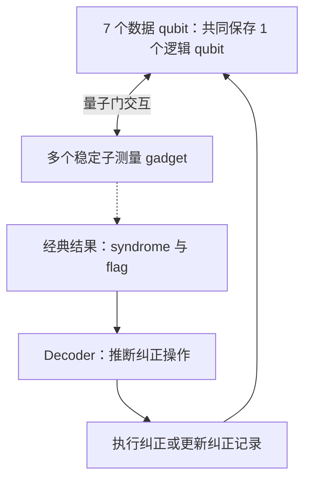

# L01 学习笔记：容错条件与 Shor 型 gadget

学习日期：2026-10-28 至 2026-10-29。状态：完成概念概览，尚未完成自测与 Gate。

来源：本次教学对话与 [L01 讲义](../teaching/L01_teaching.md)。本文整理已讲内容，不表示学习者已经独立掌握全部推导。代码数字引用现有讲义，本次会话没有运行验证脚本，也没有重新核对论文。

## 1. 学习目标与方式

项目目标是在保持测量功能与容错要求的前提下，减少量子纠错电路的资源。第一课认识被优化的对象：测量一个稳定子的 syndrome 提取 gadget。

学习者明确要求：“从上往下讲，广度搜索教学”，每次只讲一节，中文解释配合 English 术语，排版清楚。先认识系统和模块，再展开实现；不要一开始陷入接线与故障传播细节。会话中反馈过符号乱码，因此说明应配合文字，不依赖复杂符号。

起点：学习者把两个 qubit 的 parity 检查与稳定子联系起来，并提出是否一个 qubit 对应一个 gadget。不能据此假定已经掌握稳定子形式化定义。

## 2. 系统架构：gadget 是整体的一部分

Steane 码用 7 个物理数据 qubit 承载 1 个逻辑 qubit。数据共同保存编码信息，不是每个物理 qubit 各保存一个完整的逻辑 qubit。

完整工作流程：数据比特接受多项稳定子检查；每个 gadget 提取一项检查结果；收集 syndrome 和 flag；经典 decoder 决定纠正操作或更新纠正记录；数据继续参与计算。

学习者问：“一个初始 qubit 对应一个 gadget，还是 gadget 只是整体的一部分？”

回答：本课一个 gadget 对应一项稳定子检查，不对应一个 qubit。例如检查前四个数据比特的 X 型联合奇偶性，需要一个 gadget 与这四个比特相互作用。同一个数据比特可以参加多个检查。多个 gadget 可以顺序执行，辅助比特也可能重置后复用；图中多个盒子不表示复制量子数据。

## 3. 稳定子、parity 与 syndrome

### 3.1 稳定子是什么

稳定子是对合法编码态作用后保持状态不变的算符。对编码态有：

$$
S\lvert\psi\rangle=\lvert\psi\rangle.
$$

这里，$S$ 是稳定子算符，$\lvert\psi\rangle$ 是合法编码态。可以把它理解成编码态应满足的一条规则。测量稳定子，是检查该规则；单纯执行这个算符并不等于完成测量。

### 3.2 两个 qubit 的 parity 例子

学习者问：“判断两个 qubit 的 parity 也是稳定子检查？那个稳定子是什么？”

Z 基 parity 对应 $Z\otimes Z$。如果编码规定合法态处于偶 parity 子空间，这个算符就是编码的稳定子。例如：

$$
\lvert\psi\rangle=a\lvert00\rangle+b\lvert11\rangle,
\qquad |a|^2+|b|^2=1.
$$

其中 $a,b$ 是存储量子信息的复振幅。Z 保持零态不变，给一态增加负号。因此两个 Z 对双一态产生两个负号，相互抵消。

| 两比特基态 | Z 基 parity | 稳定子测量结果 |
|---|---|---|
| $\lvert00\rangle$、$\lvert11\rangle$ | 偶 | $+1$ |
| $\lvert01\rangle$、$\lvert10\rangle$ | 奇 | $-1$ |

只测 parity，区分的是两个子空间，不区分同一子空间中的两种基态，因此能保留偶子空间内部的叠加。分别测出两个比特再计算 parity，会额外读出信息，不能替代纠错中的联合测量。

parity 描述测量性质；只有对应算符确实是所用编码的稳定子时，才是该编码的稳定子检查。某项结果正常也不代表所有错误都不存在。

### 3.3 多项检查为什么能定位错误

对话用三比特重复码作简化示例，只考虑最多一次 X 翻转。合法态是全零与全一的叠加。检查 A 为 $Z_0Z_1$，检查 B 为 $Z_1Z_2$。

| 情况 | 检查 A | 检查 B |
|---|---|---|
| 无错误 | $+1$ | $+1$ |
| 第 0 比特翻转 | $-1$ | $+1$ |
| 第 1 比特翻转 | $-1$ | $-1$ |
| 第 2 比特翻转 | $+1$ | $-1$ |

中间比特参与两条检查，故其翻转同时改变两个结果。结果组合是 syndrome，decoder 根据它与假定的错误模型推断纠正方式。这个示例不能纠正任意量子错误。

## 4. 为什么检查电路也要容错

Steane 码保证能纠正任意单数据比特错误，但检查电路自身也可能出故障。一个辅助比特若依次接触多个数据比特，它的错误就可能传播到多个数据比特，超出单比特纠错保证。

必须区分 fault 与 error：前者数电路中发生的故障事件，后者描述最后数据上的错误。一次两比特门故障即使影响两个比特，仍是一次故障。

会话中的例子：用一个处于加态的辅助比特作为控制，依次对四个数据比特做 CNOT。如果它在第二、第三个 CNOT 之间出现 X 错误，后两个数据比特都会收到 X 错误。这是一次故障造成相关数据错误的例子。

重要修正：不能仅凭“影响多个比特”就认定危险。若在第一个 CNOT 后发生同类错误，留下的三个 X 在本课中可等效于单比特错误；因此讲义里用三比特传播直接说明超出能力的说法不够严谨。真正判断要按稳定子等价计算。

## 5. cat 态与 flag 的分工

### 5.1 cat 态共同提取联合性质

四个辅助比特准备成：

$$
\lvert\mathrm{cat}\rangle=\frac{\lvert0000\rangle+\lvert1111\rangle}{\sqrt{2}}.
$$

每个辅助比特只控制一个数据比特。全零分支不操作数据，全一分支作用 $S=X_0X_1X_2X_3$。

若数据满足 $S\lvert\psi\rangle=\lambda\lvert\psi\rangle$，其中 $\lambda=\pm1$，相互作用后得到：

$$
\frac{\lvert0000\rangle\lvert\psi\rangle+\lvert1111\rangle S\lvert\psi\rangle}{\sqrt{2}}
=\frac{\lvert0000\rangle+\lambda\lvert1111\rangle}{\sqrt{2}}\lvert\psi\rangle.
$$

检查结果进入 cat 态的相对相位。在 X 基测量四个辅助比特，结果的乘积等于 $\lambda$；单个结果随机。例如两个负号、两个正号相乘得到正号。改在 Z 基测量不能区分这里的相对正负号。

上面的“数据不变”解释针对具有确定稳定子本征值的输入；不要推广成任意输入测量后都不变。

### 5.2 为什么仍需要 flag

每个 cat 比特只接触一个数据比特，限制了接触数据时的直接传播。但 cat 态制备使用 CNOT，单故障可能同时弄坏多个 cat 比特。

会话用辅助比特 $a_0,a_1,a_2,a_3$ 说明：先在 $a_0$ 上做 H，再做 $a_0\to a_1$，最后做 $a_0\to a_2$ 和 $a_1\to a_3$。若 $a_1$ 制备后带 X 错误，它会通过最后一个 CNOT 传播到 $a_3$；随后两个错误分别进入数据。

本课 flag 检查 $a_0,a_1$ 的 Z parity。理想 cat 态两者总相同；上述错误使两者不同，因而报警。这项检查可通过初始化为零的 flag、两个以 cat 比特为控制且以 flag 为目标的 CNOT、以及 flag 的 Z 测量实现。

| 输出 | 含义 |
|---|---|
| syndrome | 数据稳定子的检查结果 |
| flag | 提供可能危险故障的额外信息 |

flag 不负责修复，也不保证发现所有错误。报警后的处理依赖完整协议，不能把报警自动等同于纠正成功或必须丢弃这次运行。

## 6. 电路深度：本次重点澄清

学习者先问“什么是深度”，随后问“深度越多是不是需要额外辅助 qubit”，并提出“深度是横向看的，也就是排列完任务后，需要做的任务总量”。

正确区分如下：

| 资源 | 数的对象 |
|---|---|
| qubit 数 | 同时需要多少量子比特 |
| 门数 | 总共有多少次操作 |
| 深度 | 保持依赖关系、安排并行后，依次执行多少层 |

三个不同 qubit 上的 H 可同层执行：门数为 3，深度为 1。同一 qubit 上按顺序执行 H、X、H：给定序列的门数为 3，深度为 3；若允许改写合并，新的电路可能不同。

两个 CNOT 使用互不重叠的比特时，理想情况下可并行；共用一个 qubit 时，通常需要分层。硬件还可能添加其他并行限制。

cat 制备例子中，三个 CNOT 分成两层：第一层 $a_0\to a_1$；第二层同时执行 $a_0\to a_2$ 和 $a_1\to a_3$。因此 CNOT 深度为 2，加上此前的 H，门深度为 3，不含初始化。

学习者对“横向看”的理解正确，但“任务总量”应改成“串行批次数”。对话用三条线上的 6 个门，分成每层 3、2、1 个操作，说明总门数为 6，深度为 3。学习者随后表示“明白了”。

深度增加不需要新 qubit，原 qubit 可以继续执行下一层操作。减少辅助 qubit 有时会牺牲并行性，但不是普遍定律。深度也不直接等于耗时，因为不同门、测量和等待的时间不同。

## 7. 单故障条件与稳定子等价

本课讨论的条件为：

$$
\mathrm{wt}(F)\le1\quad\text{且 flag 未报警}
\quad\Longrightarrow\quad
\mathrm{wt}_S(E_G(F))\le\mathrm{wt}(F).
$$

$F$ 是故障模式，$\mathrm{wt}(F)$ 是故障事件数；$E_G(F)$ 是 gadget 结束后的数据 Pauli 错误；$S$ 在下式表示稳定子群：

$$
\mathrm{wt}_S(E)=\min_{s\in S}\mathrm{wt}(Es).
$$

单故障未报警时，最终错误至多等效于单比特错误。报警的情况不受这个蕴含式的数据权重上限约束，但完整纠错协议仍须处理它。

为什么能乘稳定子？因为 $s$ 对编码态作用为恒等，所以 $Es$ 与 $E$ 对编码态作用相同。例如：

$$
\begin{aligned}
E&=X_0X_1X_2,\\
s&=X_0X_1X_2X_3,\\
Es&=X_3.
\end{aligned}
$$

同一位置的两个 X 抵消。因此看似三比特的错误等效于单比特错误。这个概念已经介绍，但尚未由学习者独立复述或练习确认。

## 8. 三种设计与现有代码结果

三种设计测量同一个目标稳定子。理想测量功能、容错条件、资源性能是不同检查。

| 版本 | 辅助 qubit | CNOT 数 | CNOT 深度 | 枚举单故障数 | 未报警且违规数 | 本课条件 |
|---|---:|---:|---:|---:|---:|---|
| 无 flag | 4 | 7 | 3 | 128 | 17 | 不通过 |
| 基线 | 5 | 9 | 5 | 160 | 0 | 通过 |
| 优化后 | 3 | 7 | 6 | 120 | 0 | 通过 |

这些数字来自 [既有输出](../teaching/code/L01_output.txt)，本次未重跑。辅助数量不含 7 个数据 qubit。优化版少用两个辅助 qubit、两个 CNOT，但 CNOT 深度多一层；不能由此直接推断错误率更低。

检查流程：每次重新开始，放入一个允许的故障，传播到电路末尾，观察 flag 与数据错误，再计算稳定子等价权重。这里的 17 是故障情况数，不是百分比；不同故障的概率由噪声模型决定。

检查边界：现有模型含制备、H、CNOT 和测量故障，不含空闲噪声；只检查一个 X 型 gadget，而非完整多轮协议。讲义中的两个无噪声测试输入提供证据，但不构成全部输入的证明。

## 9. 提问与纠正速查

| 学习者实际提问或理解 | 澄清 |
|---|---|
| 两个 qubit 的 parity 是稳定子检查吗？ | Z parity 对应两个 Z 的乘积；它是否为编码稳定子取决于编码定义 |
| 一个 qubit 对应一个 gadget 吗？ | 一项检查对应一个 gadget；qubit 可参加多项检查 |
| 稳定子又是什么？ | 保持合法编码态不变的算符；测量它可检验规则 |
| 深度多是否需要额外辅助 qubit？ | 不需要；深度是执行层数，qubit 数是空间资源 |
| 深度是排好任务后的任务总量？ | 总量是门数，深度是依次执行的批次数 |

不要把助手讲解过、学习者说过“继续”，等同于已经通过掌握检查。明确确认理解发生在深度概念讨论后，其余内容仍需复述或练习验证。

## 10. 未解决的问题与下一步

1. 深入理解稳定子等价：亲自化简一个数据错误，并解释为何不改变其对编码态的作用。
2. 在整体框架下阅读实际基线电路，区分数据、cat 辅助比特和 flag。
3. 选择一个具体单故障，追踪到结束，判断是否违反本课条件。
4. 完成 L01 自测与 Gate 后再勾选学习完成。

现有讲义还保留两项核对任务：从论文图 1 读取的接线需要复核；触发 flag 的故障计数与论文表 II 各差 1，原因尚未核实。本次没有解决这些问题。

学习重点是三个层次的连接：编码规定可接受的状态和可纠正的错误；gadget 提取检查信息并控制自身故障影响；decoder 利用检查结果决定纠正。优化要在功能与容错要求成立之后比较资源，不能单凭门数判断优劣。
