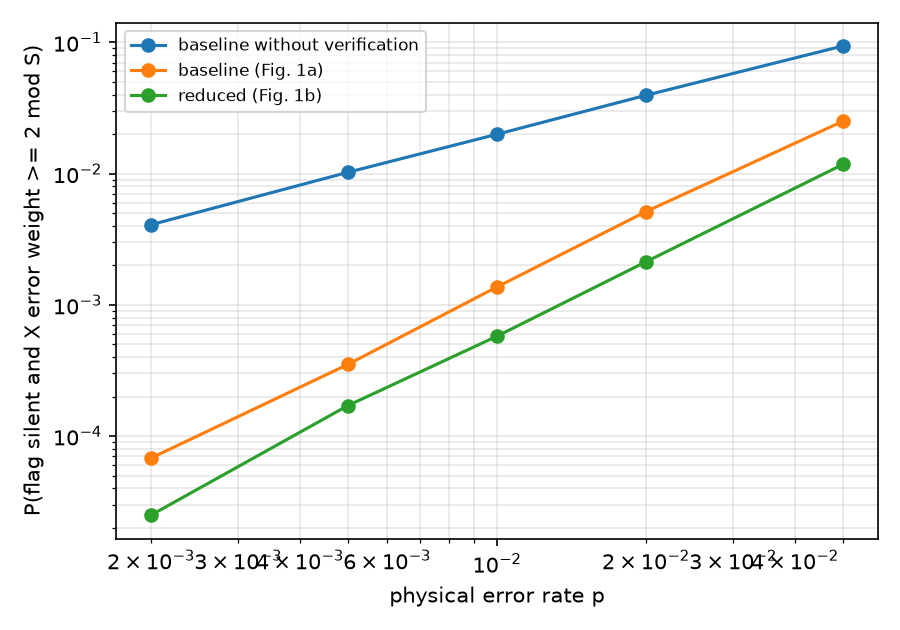

# L02 用 Stim 做带噪声的模拟：从单故障枚举到错误率的 scaling

材料：Jeon et al.（arXiv:2610.09749）第 V A 节（PDF 第 5 页，噪声模型）；Gidney, *Stim: a fast stabilizer circuit simulator*, Quantum 5, 497 (2021)，只需要知道它是什么；Stim 官方文档里 `stim.Circuit` 和 `compile_sampler` 两节。Stim 的基础用法（detector、DEM）在 `Quantum Learning/QEC_Prereq/01_Surface_Code_Memory_Stim/` 里讲过，这一课只用到其中最简单的部分。

代码：[code/L02_noisy_gadgets.py](code/L02_noisy_gadgets.py)，输出 [code/L02_output.txt](code/L02_output.txt)，图 [figures/L02_malignant_vs_p.png](figures/L02_malignant_vs_p.png)；手算对照 [code/L02_first_order.py](code/L02_first_order.py)，输出 [code/L02_first_order_output.txt](code/L02_first_order_output.txt)。共用工具在 L01 的 [ftlib.py](../../L01_FT_and_Shor_Gadget/teaching/code/ftlib.py)。

## 1. 这一课讲什么

L01 一次只放一个故障进电路，逐个检查（枚举）。真实硬件上每个位置都以一定概率出错，可能同时出好几个。这一课用 Stim 给电路加上 Jeon 论文的噪声比例，采样一百万次，统计"flag 没报警、但数据上留下了纠不了的错误"的概率，看它怎么随物理错误率 $p$ 变化。结论是：满足 $\mathrm{FT}_1$ 的电路，这个概率按 $p^2$ 增长；不满足的按 $p$ 增长。这也是以后评估候选电路好坏的基本方法。

## 2. 符号表

| 符号 | 含义 | 容易混的地方 |
|---|---|---|
| $p$ | 物理错误率：两比特门后出错的概率 | 不同位置的错误率按 $p$ 的比例设 |
| $p_1$ | 单比特门的错误率，$p_1 = 3p/100$ | |
| $p_{\mathrm{SPAM}}$ | 制备和测量错误率，取 $p$ | |
| 坏结果（malignant） | flag 没报警，且数据上的 $X$ 错误按 $X$ 型稳定子算权重 $\ge 2$ | 只看了 $X$ 错误，见第 3 节 |
| $P_{\mathrm{bad}}(p)$ | 坏结果的概率 | |
| $c_k$ | $P_{\mathrm{bad}}$ 按 $p$ 展开的第 $k$ 阶系数 | |
| shots | 采样次数 | 每个 $p$ 点 $10^6$ 次 |

## 3. 概念：先白话，再定义

**Stim 是什么。** 一个专门模拟稳定子电路（只含 Clifford 门和 Pauli 噪声）的程序，速度很快，一秒能采几百万次。我们只用它做一件事：搭好电路，加上噪声，大量采样测量结果。

**这一课用到的 Stim 指令**（`ftlib.to_stim` 里全部用到）：

| 指令 | 作用 |
|---|---|
| `R q` / `RX q` | 把 $q$ 制备成 $\lvert 0 \rangle$ / $\lvert + \rangle$ |
| `H q`、`CX c t` | Hadamard、CNOT |
| `M q` / `MX q` | 在 $Z$ / $X$ 基测量，结果按顺序写进测量记录 |
| `X_ERROR(p) q` | 以概率 $p$ 对 $q$ 施加 $X$ |
| `DEPOLARIZE1(p) q` | 以概率 $p$ 施加 $X,Y,Z$ 之一，各 $p/3$ |
| `DEPOLARIZE2(p) a b` | 以概率 $p$ 施加 15 种非单位两比特 Pauli 之一，各 $p/15$ |
| `circuit.compile_sampler().sample(shots)` | 采样，返回 shots 行、每行一条测量记录 |

**噪声模型**（按 Jeon 第 V A 节的比例）：每个 CNOT 后 `DEPOLARIZE2(p)`，每个 H 后 `DEPOLARIZE1(3p/100)`，每次制备后和每次测量前 `X_ERROR(p)`。论文还有空闲错误（$p/10$），这一课**没有加**。数据的初始制备和最后测量保持无噪声，只让 gadget 本身有噪声。

**怎么判断数据坏了。** 数据比特从 $\lvert 0 \rangle^{\otimes 7}$ 开始，gadget 跑完后在 $Z$ 基测量。$X$ 错误会让对应比特变成 1，于是一行测量记录里数据部分的 1 就是 $X$ 错误的位置。再按 $X$ 型稳定子（3 个生成元，共 8 个群元素）取最小权重。

为什么只看 $X$ 错误：这一课的 gadget 测的是 $X$ 型稳定子，cat 比特是 CNOT 的控制，传到数据上的是 $X$。数据上的 $Z$ 错误在 $Z$ 测量里看不见，所以没统计，这是这一课的一个限制。

还有一个细节：在 $\lvert 0 \rangle^{\otimes 7}$ 上测 $X_{0123}$，会把数据投影到 $X_{0123}$ 的本征态，数据测量时 $q_0..q_3$ 会随机出现 0000 或 1111。1111 正好是 $X_{0123}$ 这个稳定子，按稳定子等价算权重是 0，不会被误判为错误。

## 4. 一步步推导：为什么 $\mathrm{FT}_1$ 意味着 $p^2$

第 1 步：把坏结果的概率按故障个数展开。电路里有 $N$ 个可能出错的位置，各自独立地以 $O(p)$ 的概率出错：

$$
P_{\mathrm{bad}}(p) = c_1 p + c_2 p^2 + c_3 p^3 + \cdots
$$

$c_1 p$ 是"恰好一个故障就造成坏结果"的概率，$c_2 p^2$ 是"需要两个故障"的概率，依此类推。

第 2 步：$c_1$ 等于所有"单独就能造成坏结果"的单故障的概率之和（再除以 $p$）：

$$
c_1 = \frac{1}{p}\sum_{\text{坏的单故障 } f} \Pr(f)
$$

第 3 步：$\mathrm{FT}_1$ 说的就是"没有一个未被检测的单故障会留下权重 $\ge 2$ 的错误"，所以满足 $\mathrm{FT}_1$ 时 $c_1 = 0$：

$$
P_{\mathrm{bad}}(p) = c_2 p^2 + O(p^3)
$$

第 4 步：两边取对数，

$$
\log P_{\mathrm{bad}} \approx \log c_2 + 2 \log p
$$

在 log-log 图上是斜率为 2 的直线。不满足 $\mathrm{FT}_1$ 时 $c_1 \ne 0$，小 $p$ 下斜率为 1。

读法：**斜率就是"至少要几个故障才会出事"。** 这比看某一个 $p$ 下的数值更能说明电路是否容错。

## 5. 完整数值例子：手算无 flag 版本的 $c_1$

L01 找出了无 flag 版本的 17 个违规单故障。按噪声模型给每个故障标上概率：

| 故障类型 | 个数 | 每个的概率 | 小计（除以 $p$） |
|---|---|---|---|
| $q_8$ 的制备错误 | 1 | $p$ | $1$ |
| CNOT 之后的两比特 Pauli | 16 | $p/15$ | $16/15 \approx 1.0667$ |
| 合计 | 17 | | $c_1 \approx 2.0667$ |

所以预测

$$
P_{\mathrm{bad}}(2 \times 10^{-3}) \approx 2.0667 \times 2 \times 10^{-3} = 4.13 \times 10^{-3}
$$

蒙特卡洛测到的是 $4.08 \times 10^{-3}$（第 6 节）。差 1% 左右，在统计误差和高阶项的范围内（4078 个坏结果的相对标准误约为 $1/\sqrt{4078} \approx 1.6\%$）。$p = 5\times 10^{-3}$ 时预测 $1.03 \times 10^{-2}$，测到 $1.02 \times 10^{-2}$。

## 6. 代码结果

`L02_first_order.py` 的输出（末尾三行）：

```text
first-order coefficient c1 = 2.0667
predicted P(malignant) at p = 2e-3: 4.13e-03;  at p = 5e-3: 1.03e-02
```

`L02_noisy_gadgets.py` 的输出（每个 $p$ 点 $10^6$ 次）：

```text
Example: the noiseless baseline gadget as a Stim circuit (data in |0>^7)
R 0 1 2 3 4 5 6 7 8 9 10 11
H 7
CX 7 8 7 9 8 10 7 11 7 0 8 11 8 1 9 2 10 3
H 7 8 9 10
M 7 8 9 10 11 0 1 2 3 4 5 6

========================================================================
baseline without verification (1000000 shots per point)
  p = 2e-03: flag rate 0.0000, malignant shots    4078, rate 4.08e-03
  p = 5e-03: flag rate 0.0000, malignant shots   10233, rate 1.02e-02
  p = 1e-02: flag rate 0.0000, malignant shots   19938, rate 1.99e-02
  p = 2e-02: flag rate 0.0000, malignant shots   39510, rate 3.95e-02
  p = 5e-02: flag rate 0.0000, malignant shots   93880, rate 9.39e-02
  log-log slope, all points: 0.97; points with p <= 1e-2: 0.99
========================================================================
baseline (Fig. 1a) (1000000 shots per point)
  p = 2e-03: flag rate 0.0113, malignant shots      68, rate 6.80e-05
  p = 5e-03: flag rate 0.0276, malignant shots     352, rate 3.52e-04
  p = 1e-02: flag rate 0.0538, malignant shots    1369, rate 1.37e-03
  p = 2e-02: flag rate 0.1023, malignant shots    5134, rate 5.13e-03
  p = 5e-02: flag rate 0.2235, malignant shots   25074, rate 2.51e-02
  log-log slope, all points: 1.85; points with p <= 1e-2: 1.86
========================================================================
reduced (Fig. 1b) (1000000 shots per point)
  p = 2e-03: flag rate 0.0080, malignant shots      25, rate 2.50e-05
  p = 5e-03: flag rate 0.0202, malignant shots     171, rate 1.71e-04
  p = 1e-02: flag rate 0.0399, malignant shots     577, rate 5.77e-04
  p = 2e-02: flag rate 0.0770, malignant shots    2129, rate 2.13e-03
  p = 5e-02: flag rate 0.1750, malignant shots   11751, rate 1.18e-02
  log-log slope, all points: 1.90; points with p <= 1e-2: 1.96
```



每项结果说明了什么：

| 结果 | 说明了什么 |
|---|---|
| 无 flag 版本斜率 0.97–0.99 | 一个故障就够造成坏结果，和 L01 的 17 个违规一致；数值和手算的 $c_1$ 吻合 |
| 基线斜率 1.85–1.86，优化后 1.90–1.96 | 至少要两个故障才会出事，和 L01 的 $\mathrm{FT}_1$ 一致。斜率略低于 2，因为大 $p$ 处 $p^3$ 项和采样误差的影响；只用 $p \le 10^{-2}$ 的点时更接近 2 |
| 同一个 $p$ 下，优化后的坏结果概率约为基线的 0.4 倍（$p=10^{-2}$：$5.77 \times 10^{-4}$ 对 $1.37 \times 10^{-3}$） | 优化后的电路门更少、出错位置更少。下一课会讲：两个电路"故障等价"，但错误率不同 |
| flag 触发率：优化后比基线低 | 优化后 flag 前面的门更少。论文报告的是整轮（6 个 gadget、3 轮）的触发率，和这里的单 gadget 数字不能直接比 |

**这些结果的边界：**
- 只看了数据上的 $X$ 错误，没有看 $Z$ 错误；没有空闲噪声；只模拟了一个 gadget，不是完整的纠错循环。
- 坏结果的定义只是"flag 没报警 + 权重 $\ge 2$"，没有经过解码器。论文里的逻辑错误率要经过多轮测量和查表解码，数值不能和这里直接比较。
- $p = 2\times 10^{-3}$ 时优化后电路只有 25 个坏结果，相对误差约 20%。要在更小的 $p$ 下估计，需要更多 shots，或者重要性采样之类的方法（阶段 2 会用到）。

## 7. 常见误区

| 错误想法 | 为什么容易这样想 | 正确的理解 |
|---|---|---|
| 某个 $p$ 下错误率低就说明电路容错 | 只看了一个数 | 容错看的是 scaling（斜率），一个点说明不了是 $c_1 p$ 小还是 $c_1 = 0$ |
| 斜率不是正好 2，所以不容错 | 期待精确的整数 | 高阶项和统计误差会让斜率偏离；小 $p$ 下应趋近 2 |
| 单故障枚举和蒙特卡洛二选一 | 两种方法都在"找错误" | 枚举精确地回答"有没有坏的单故障"（$c_1$ 是否为 0）；蒙特卡洛给出包含多故障的总概率，两者互相印证 |
| `DEPOLARIZE2(p)` 每种 Pauli 概率为 $p$ | 参数写的是 $p$ | 总概率 $p$，15 种各 $p/15$ |
| 测到数据 $q_0..q_3$ 全是 1 就是 4 比特错误 | 4 个 1 很显眼 | 这是投影到 $X_{0123}$ 本征态的正常结果，按稳定子算权重为 0 |

## 8. 自测

**1.**（数值）基线电路有多少个 CNOT？在这个噪声模型下，一次运行里"所有 CNOT 都没有出错"的概率，在 $p = 10^{-2}$ 时是多少？

<details><summary>答案</summary>

9 个 CNOT，每个以 $1-p$ 的概率不出错，$(1-0.01)^9 \approx 0.914$。也就是说约 8.6% 的运行里至少有一个 CNOT 出错，但其中大部分不会造成坏结果。
</details>

**2.** 如果把 `DEPOLARIZE2(p)` 换成"CNOT 后只可能出 $X \otimes X$，概率 $p$"，无 flag 版本的 $c_1$ 会怎么变？

<details><summary>答案</summary>

要重新数哪些 CNOT 后的 $XX$ 会造成坏结果，并且每个的概率变成 $p$ 而不是 $p/15$。比如 L01 的违规列表里有 CX $7\to 9$ 后的 $XX$、CX $8\to 10$ 后的 $XX$，各贡献 1；CX $7\to 8$ 后的 $XX$ 会让 4 个 cat 比特都翻转，等于 cat 态的稳定子，不造成错误。再加上制备错误，$c_1$ 大约是 3。重点在于：$c_1$ 取决于噪声模型，而"$c_1$ 是否为 0"（即 $\mathrm{FT}_1$）对这类模型不变。
</details>

**3.**（边界情况）$p = 5\times 10^{-2}$ 时，基线的坏结果概率是 $2.51 \times 10^{-2}$，比 $p$ 的平方 $2.5\times10^{-3}$ 大很多，这和"按 $p^2$ 增长"矛盾吗？

<details><summary>答案</summary>

不矛盾。$p^2$ scaling 说的是 $P_{\mathrm{bad}} \approx c_2 p^2$，系数 $c_2$ 可以远大于 1（有很多对故障组合都能造成坏结果）。从数据估计，$c_2 \approx 1.37 \times 10^{-3} / 10^{-4} \approx 14$。大 $p$ 时高阶项也开始起作用。
</details>

**4.**（新情形）阶段 2 要在更大的码上比较很多候选电路。如果某个候选的 $P_{\mathrm{bad}}$ 在 $p = 10^{-3}$ 时约为 $10^{-6}$，想让坏结果的相对误差小于 10%，大约需要多少 shots？

<details><summary>答案</summary>

相对误差约为 $1/\sqrt{n_{\mathrm{bad}}}$，要小于 10% 需要 $n_{\mathrm{bad}} \gtrsim 100$。shots $\approx 100 / 10^{-6} = 10^8$。每个候选都这样算就太贵了，所以阶段 2 要用代理指标先筛选，或者用重要性采样。
</details>

## 9. Gate

不看笔记，用 3–5 句话回答：为什么满足 $\mathrm{FT}_1$ 的 gadget，坏结果概率在小 $p$ 下按 $p^2$ 增长？这一课的模拟结果怎样支持这一点？这个模拟有哪些地方和论文的完整逻辑错误率不同？

<details><summary>参考答案</summary>

把坏结果概率按故障个数展开为 $c_1 p + c_2 p^2 + \cdots$，$c_1$ 是能单独造成坏结果的单故障概率之和；$\mathrm{FT}_1$ 保证没有这样的未检测单故障，所以 $c_1 = 0$，领头项是 $p^2$，log-log 图上斜率为 2。模拟中，无 flag 版本斜率约 1，而且数值和用 L01 的 17 个违规故障手算的 $c_1 \approx 2.07$ 吻合；基线和优化后电路的斜率约 1.86 和 1.96，接近 2。和论文的不同之处：只看了数据上的 $X$ 错误，没有空闲噪声，只模拟了一个 gadget，而且没有经过多轮测量和解码器，所以不是逻辑错误率。
</details>

## 10. 下一课

L03 讲 fault equivalence（故障等价）：什么时候两个电路"出错时的表现相同"。这一课已经看到，基线和优化后电路都容错、但错误率差了约 2.4 倍；下一课会把这两件事分开讲清楚。
