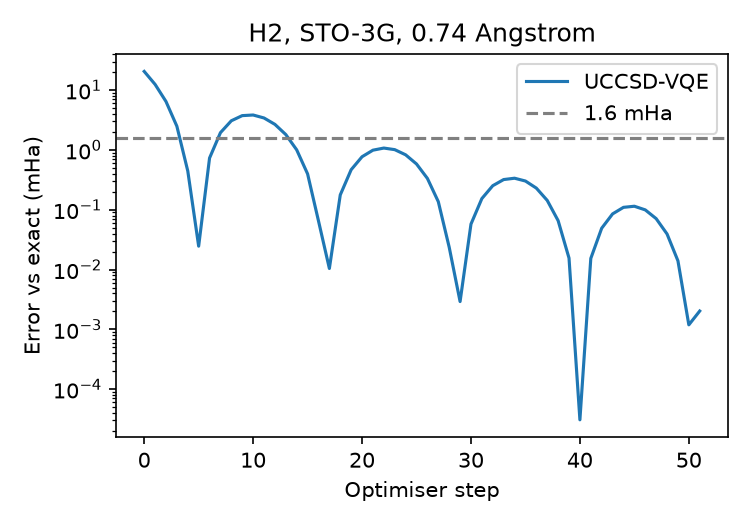
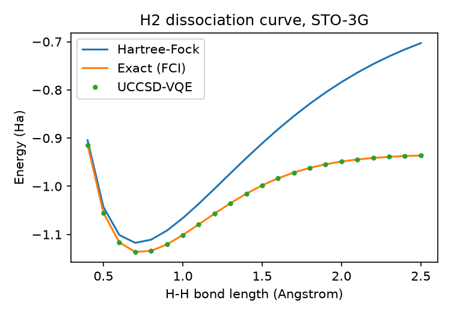
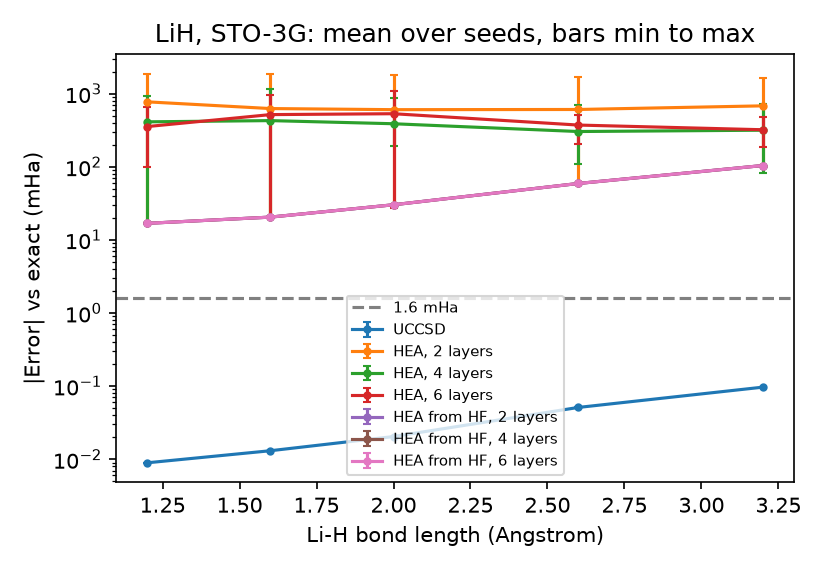
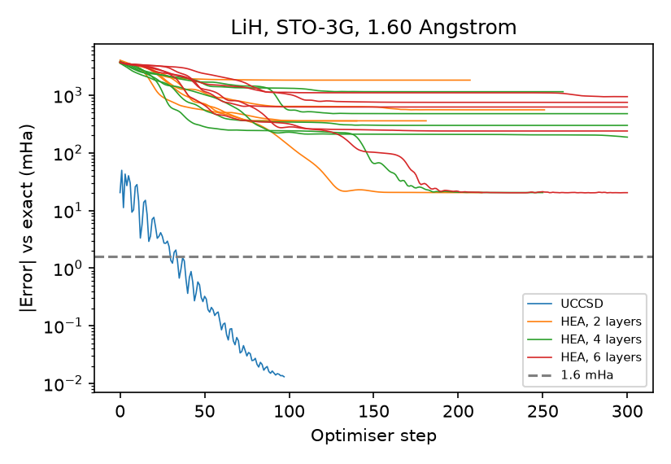
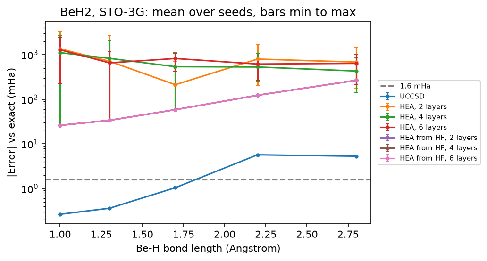
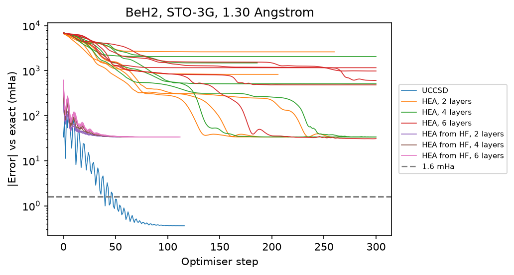
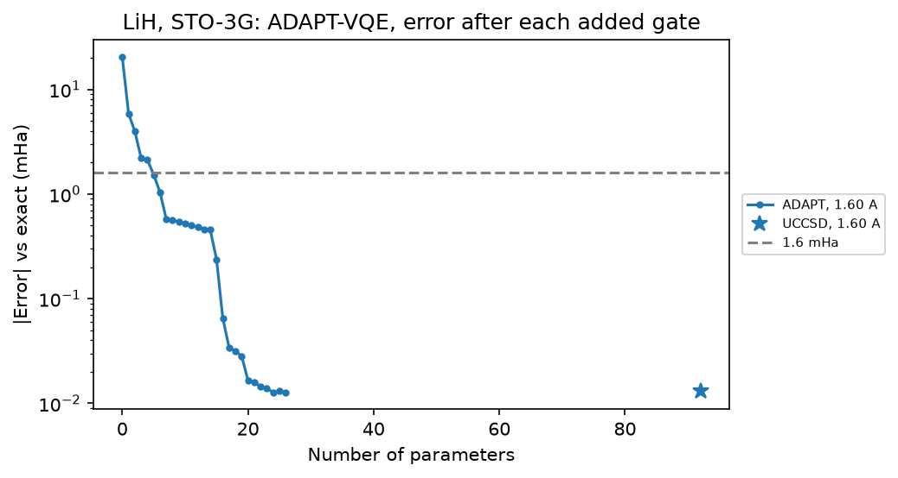

# VQE_Molecules

A comparison of variational quantum eigensolver (VQE) ansätze on the ground-state energy of H2, LiH and BeH2, on a noiseless statevector simulator.

## Summary

- **Question.** Under one optimisation budget, which is easier to train to chemical accuracy (1.6 mHa): UCCSD, which is built for the problem, or a generic hardware-efficient ansatz (HEA)?
- **H2 (4 qubits)** checks the pipeline. UCCSD is within 0.01 mHa of the exact energy at all 22 bond lengths.
- **LiH (12 qubits)** is the comparison. UCCSD (92 parameters) reached chemical accuracy at 5 of 5 bond lengths, with errors from 0.009 to 0.097 mHa. The HEA with random initial angles reached it in 0 of 75 runs; its best runs ended at the Hartree–Fock energy, which is where UCCSD starts.
- **Control for the starting point.** Starting the HEA next to the Hartree–Fock state removed the spread between seeds, but all 75 control runs settled on the Hartree–Fock energy and none went below it. The starting point explains the large errors of the randomly initialised HEA; it does not explain its failure to reach chemical accuracy.
- **BeH2 (14 qubits)** repeats the comparison on a larger molecule. UCCSD (204 parameters) reached chemical accuracy at 3 of 5 bond lengths and ended at 5.7 and 5.3 mHa at the two stretched ones. Both HEA results carried over: 0 of 75 runs within chemical accuracy from random angles, and all 75 runs started from Hartree–Fock ended on the Hartree–Fock energy.
- **ADAPT-VQE**, first result. Selecting UCCSD's gates one at a time by gradient, LiH at 1.60 Å reached chemical accuracy with 5 parameters and matched UCCSD's final error with 26, against 92 for UCCSD. It needed 2308 optimiser steps in total against 97. The other four bond lengths have not been run.

## Roadmap

| Step | Content | Status |
|---|---|---|
| 1 | H2 Hamiltonian and reference energies | Done |
| 2 | UCCSD-VQE on H2, dissociation curve | Done |
| 2c | The H2 VQE again in Qiskit, as a cross-check | Done |
| 3 | LiH: UCCSD against HEA, with a control for the starting point | Done |
| 4 | BeH2 (14 qubits): UCCSD against HEA | Done |
| 5 | ADAPT-VQE: error against number of parameters, compared with UCCSD | H2 check and LiH at 1.60 Å done; 4 LiH bond lengths to run |
| 6 | CPU against GPU statevector simulation time on hydrogen chains | Script written (`step05_gpu_scaling.py`), not yet run |

## Files

| Script in `code/` | What it does | Output |
|---|---|---|
| `vqe_common.py` | Shared helpers: geometry, Hamiltonian, reference energies, optimisation loop | |
| `step01_h2_hamiltonian.py` | H2 Hamiltonian at 0.74 Å and its reference energies | `results/step01_output.txt` |
| `step02_h2_vqe.py` | UCCSD-VQE on H2: one geometry, then 22 bond lengths | `results/h2_dissociation.csv`, `results/step02_output.txt`, `figures/h2_*.png` |
| `step02b_h2_checks.py` | Matrix elements of the H2 Hamiltonian and a single-gate ansatz | `results/step02b_output.txt` |
| `step02c_h2_qiskit.py` | The H2 VQE in Qiskit: the same Hamiltonian as a `SparsePauliOp`, a one-parameter circuit with three CNOTs | `results/h2_qiskit.csv`, `results/step02c_output.txt` |
| `step03_uccsd_vs_hea.py` | UCCSD against HEA on LiH or BeH2 (`--molecule`): 5 bond lengths, 3 depths, 5 seeds, 2 ways of starting the HEA | `results/lih_ansatz.csv`, `results/lih_histories.jsonl`, `figures/lih_*.png`; the same with `beh2_` for BeH2 |
| `step04_adapt_vqe.py` | ADAPT-VQE on H2, LiH or BeH2 (`--molecule`): the circuit grows by one UCCSD gate per iteration, chosen by its gradient | `results/<molecule>_adapt.csv`, `results/<molecule>_adapt_histories.jsonl`, `figures/<molecule>_adapt_error_vs_params.png` |

`lih_ansatz.csv` has one row per training run. `lih_histories.jsonl` has the energy at every optimiser step of every run. The `.txt` files are console output.

## Method

- **Hamiltonian.** `qml.qchem`, STO-3G basis, Jordan–Wigner mapping. The chemistry is used as a black box that turns a geometry into a qubit Hamiltonian.
- **Loss.** The energy ⟨H⟩ of the circuit's output state. No reference value enters the training.
- **Reference values.** The Hartree–Fock (HF) energy is the diagonal element of the Hamiltonian at the HF basis state. The exact energy is the lowest eigenvalue of the Hamiltonian restricted to basis states with the correct number of electrons, which equals the FCI energy in the same basis. Errors are reported against the exact energy.
- **Budget, shared by all runs.** `lightning.qubit` with adjoint differentiation; Adam with step size 0.05; at most 300 steps; stop after 5 consecutive steps that each change the energy by less than 1e-6 Ha.
- **UCCSD.** Starts from the HF state with all parameters at zero. Deterministic, so one run per geometry.
- **HEA.** Each layer applies RY and RZ to every qubit, then a ring of CNOTs. Starts from |0…0⟩ with angles drawn uniformly from [−π, π). Depths of 2, 4 and 6 layers, 5 seeds each.
- **HEA from HF (control).** The same circuit, started from the basis state that its CNOT rings map onto the HF state, so that with every angle at zero the output is exactly the HF state. Angles are drawn uniformly from [−0.1, 0.1); this range was not tuned.

## Results for H2

At 0.74 Å ([results/step01_output.txt](results/step01_output.txt)):

| Quantity | Value |
|---|---|
| Qubits | 4 |
| Pauli terms | 15 |
| Hartree–Fock energy | −1.116759 Ha |
| Exact energy | −1.137284 Ha |
| Correlation energy | −20.525 mHa |

UCCSD has 3 parameters here (2 singles, 1 double). At 0.74 Å it reached −1.137284 Ha in 86 steps, an error of 0.0003 mHa.



Along the dissociation curve, 22 bond lengths from 0.4 to 2.5 Å ([results/h2_dissociation.csv](results/h2_dissociation.csv)): all 22 are within chemical accuracy. The largest error is 0.0099 mHa at 2.1 Å, and the optimiser took between 81 and 106 steps.



A single `DoubleExcitation` gate on the HF state already gives the exact energy at 0.74 Å (θ = 0.2256, [results/step02b_output.txt](results/step02b_output.txt)), because the ground state is a superposition of |1100⟩ and |0011⟩ only. The errors above therefore come from the optimiser, not from the ansatz. The stopping rule shows this directly: when the optimiser stopped at the first step below the tolerance, the largest error was 0.77 mHa at 1.1 Å after 34 steps and 5 of the 22 points were above 0.1 mHa. The stored results require 5 consecutive steps.

**Cross-check in Qiskit** ([results/step02c_output.txt](results/step02c_output.txt)). The Hamiltonian built by PennyLane was converted to a Qiskit `SparsePauliOp` and minimised over a hand-built circuit that prepares cos(θ/2)|1100⟩ + sin(θ/2)|0011⟩ with one RY and three CNOTs, using Qiskit's statevector estimator (Qiskit 2.5.2). At 6 bond lengths from 0.5 to 2.5 Å the minimum agrees with the exact energy to within 1e-12 Ha, and the HF energy from the Qiskit circuit agrees with the PennyLane matrix element to 2e-16 Ha. At 0.74 Å the optimal angle is −0.2256, the same magnitude as the `DoubleExcitation` angle above. One run, on a Windows laptop.

## Results for LiH

LiH has 12 qubits, 4 electrons and 631 Pauli terms. All numbers below are from [results/lih_ansatz.csv](results/lih_ansatz.csv) and [results/lih_histories.jsonl](results/lih_histories.jsonl): 155 training runs, each done once.

Errors against the exact energy, in mHa:

| Bond length (Å) | HF state, before training | UCCSD, 92 parameters | HEA, random start: best of 15 | HEA from HF: range over 15 |
|---|---|---|---|---|
| 1.20 | 16.815 | 0.009 | 16.818 | 16.816 to 16.822 |
| 1.60 | 20.460 | 0.013 | 20.388 | 20.461 to 20.466 |
| 2.00 | 30.182 | 0.020 | 27.186 | 30.183 to 30.189 |
| 2.60 | 58.996 | 0.051 | 58.996 | 58.997 to 59.002 |
| 3.20 | 103.858 | 0.097 | 83.112 | 103.859 to 103.863 |

Runs within chemical accuracy: UCCSD 5 of 5, HEA with random start 0 of 75, HEA from HF 0 of 75.



Points are the mean over seeds; bars run from the smallest to the largest error. The three "HEA from HF" lines lie on top of each other.

**UCCSD** stopped after 95 to 106 steps at every bond length, so the 300-step budget did not limit it. Its error grows with the bond length. Its first Adam step raises the error at all 5 bond lengths (from 20.5 to 49.8 mHa at 1.60 Å); the energy then oscillates downwards and first passes 1.6 mHa after 30 to 35 steps.

**HEA with random start** by depth, over the 25 runs at each depth (5 bond lengths × 5 seeds):

| Layers | Parameters | Mean error (mHa) | Median error (mHa) | Runs that used all 300 steps |
|---|---|---|---|---|
| 2 | 48 | 657 | 467 | 4 of 25 |
| 4 | 96 | 369 | 300 | 16 of 25 |
| 6 | 144 | 418 | 397 | 24 of 25 |

- Ten of the 75 runs ended at the HF energy or below it (no more than 0.2 mHa above). The other 65 ended above the HF energy, which UCCSD has before any training.
- The lowest HEA error relative to the HF energy was at 3.20 Å: 83.1 mHa against 103.9 mHa.
- The spread over seeds is as large as the mean. At 1.60 Å with 2 layers, the errors of the 5 seeds run from 20.5 to 1825 mHa. With this spread, 4 and 6 layers cannot be ranked.
- 31 runs met the stopping rule before 300 steps, all of them with an error of at least 16.8 mHa. Meeting the stopping rule says the energy has stopped changing, not that it is close to the exact energy.
- The HEA does not conserve the number of electrons, so it could in principle go below the exact energy of the 4-electron sector. It did not: at all 5 bond lengths the lowest eigenvalue over all sectors equals the exact energy, and no run has a negative error.

**HEA from HF (control).**

- Before training, the 75 control runs are 90 to 338 mHa above the exact energy: near the HF state, and further from it with more layers, because every angle is perturbed (90 to 191 mHa with 2 layers, 216 to 338 mHa with 6).
- All 75 runs then came back to the HF energy, ending between 0.001 and 0.007 mHa above it, and met the stopping rule after 87 to 109 steps. None ended below the HF energy.
- The spread over seeds fell from hundreds of mHa to about 0.002 mHa. The large errors and the seed dependence of the randomly initialised HEA therefore come from its starting point.
- A fair start did not make the HEA reach chemical accuracy. From the same state, UCCSD recovered more than 99.9% of the gap between the HF and exact energies and the HEA recovered none of it.
- The circuit can represent states below the HF energy: with a random start, one 4-layer run at 3.20 Å ended at 83.1 mHa, 20.7 mHa below HF, while the five 4-layer runs started from HF ended at 103.86 mHa. At least in that case the limit is the optimisation, not what the circuit can express.



## Results for BeH2

BeH2 is linear, with both Be–H bonds stretched together. It has 14 qubits, 6 electrons and 666 Pauli terms. The settings are those of LiH; UCCSD has 204 parameters and the HEA 56, 112 or 168. All numbers are from [results/beh2_ansatz.csv](results/beh2_ansatz.csv) and [results/beh2_histories.jsonl](results/beh2_histories.jsonl): 155 training runs.

Errors against the exact energy, in mHa:

| Be–H bond length (Å) | HF state, before training | UCCSD, 204 parameters | HEA, random start: best of 15 | HEA from HF: range over 15 |
|---|---|---|---|---|
| 1.00 | 26.073 | 0.265 | 26.074 | 26.075 to 26.080 |
| 1.30 | 33.769 | 0.361 | 31.101 | 33.770 to 33.774 |
| 1.70 | 58.516 | 1.041 | 58.518 | 58.517 to 58.520 |
| 2.20 | 123.318 | 5.699 | 200.763 | 123.319 to 123.325 |
| 2.80 | 266.889 | 5.296 | 142.490 | 266.890 to 266.894 |

Runs within chemical accuracy: UCCSD 3 of 5, HEA with random start 0 of 75, HEA from HF 0 of 75.



What carried over from LiH, and what did not:

- **UCCSD no longer passes everywhere.** It is within chemical accuracy at 1.00, 1.30 and 1.70 Å and ends at 5.7 and 5.3 mHa at 2.20 and 2.80 Å. It recovered between 95.4% and 99.0% of the gap between the HF and exact energies, against more than 99.9% on LiH.
- **This data does not say why.** All five UCCSD runs met the stopping rule after 112 to 121 steps, well before the 300-step limit. Over their last 20 steps the energy fell by 0.003 to 0.055 mHa, so the curves were nearly flat with 0.3 to 5.7 mHa still to go. A limit of the ansatz and a slow plateau that the stopping rule cuts short both fit; a run with a looser stopping rule would separate them and was not done.
- **HEA with random start: 0 of 75**, as on LiH. 49 of the 75 runs used all 300 steps, including all 25 six-layer runs.
- **HEA from HF: all 75 runs ended on the HF energy**, between 0.001 and 0.007 mHa above it, after 90 to 112 steps. This is the LiH result again.
- **At 2.80 Å the HF state is a poor starting point, and the random start does better.** Five of the 15 randomly initialised runs ended below the HF energy, the best at 142.5 mHa against 266.9 mHa, while all 15 runs started from HF stayed at 266.9 mHa. The circuit can represent much better states than the one it stays at when started from HF.
- As on LiH, the lowest eigenvalue over all sectors equals the exact energy at every bond length, and no run has a negative error.



## ADAPT-VQE: first results

ADAPT-VQE starts from the HF state with no gates. Each iteration computes, for every gate in a pool, the gradient of the energy if that gate were appended at angle zero; appends the gate with the largest gradient; and retrains all angles with the same Adam budget as above. It stops when the largest gradient is below 1e-3 Ha per radian or after 40 gates. Neither rule uses the exact energy. The pool is the set of gates UCCSD is built from, so the only difference from UCCSD is that gates are selected one at a time.

**H2 at 0.74 Å** ([results/h2_adapt.csv](results/h2_adapt.csv)). The pool has 3 gates. The first iteration selected the double excitation, with gradient 0.181210 Ha per radian, and training gave an error of 0.0003 mHa in 86 steps. The second iteration stopped: the largest remaining gradient was 6.95e-4. One parameter, against 3 for UCCSD.

**LiH at 1.60 Å** ([results/lih_adapt.csv](results/lih_adapt.csv)), one run. The pool has 92 gates (76 doubles, 16 singles).

| | ADAPT-VQE | UCCSD |
|---|---|---|
| Parameters when the error first falls below 1.6 mHa | 5 | 92 (fixed) |
| Parameters at the end | 26 | 92 |
| Final error (mHa) | 0.0127 | 0.0131 |
| Optimiser steps, summed over iterations | 2308 | 97 |



- The largest gradient fell from 0.124 at the first iteration to 0.001 at the last; the run stopped on the gradient rule at 8.94e-4.
- The 26 selected gates are all different. The first 14 are doubles.
- Gradient order is not gain order. Gates 8 to 14, all doubles, lowered the error from 0.56 to 0.45 mHa. The next three, the first singles to be selected, lowered it from 0.45 to 0.03 mHa. Whether selecting those singles earlier would have reached the same error with fewer gates was not tested.
- Wall time is not compared: this run shared two CPU cores with other jobs.

## Reproduce

From `VQE_Molecules/code/`, with the environment from the top-level README:

```
python step01_h2_hamiltonian.py
python step02_h2_vqe.py
python step02b_h2_checks.py
python step03_uccsd_vs_hea.py --molecule LiH --quick       # 3 steps per run: checks the script and gives timings
python step03_uccsd_vs_hea.py --molecule LiH               # 155 runs; 48 minutes of training on a cluster CPU node
python step03_uccsd_vs_hea.py --molecule LiH --plot-only   # redraw the figures from the CSV
python step03_uccsd_vs_hea.py --molecule BeH2              # 155 runs
python step04_adapt_vqe.py --molecule H2
python step04_adapt_vqe.py --molecule LiH --bond-lengths 1.6
```

`step03_uccsd_vs_hea.py` appends one row to the CSV after every run and skips runs that are already there, so an interrupted job can be restarted with the same command. It also appends its console output to `results/step03_lih_output.txt`. The stored LiH results were produced by an earlier version of the script, `step03_lih_vqe.py`, in two invocations (80 runs, then the 75 control runs) and before the console log was added, so that file is not in the repository. Both LiH figures were redrawn from the CSV with `--plot-only` after the runs.

The BeH2 experiment was started in two processes at the same time, so every run was done twice and written twice. The two copies agree exactly in the optimised energy, the number of steps and the whole energy history; the reference energies differ by at most 1e-13 Ha. The stored CSV and history files keep one copy of each run, and `results/step03_beh2_output.txt` is the unedited console output of both processes interleaved. The script now checks the CSV before every run, not only when it starts. The `seconds` column of the BeH2 and ADAPT files was recorded with several jobs sharing two cores and should not be used as a timing.

## Limitations

- Noiseless statevector simulation: no shot noise, no device noise.
- STO-3G is a minimal basis. "Exact" means exact within this basis, not the energy of the real molecule.
- Each number comes from a single run, except BeH2, where an accidental second copy of all 155 runs gave the same energies and step counts.
- The control shows that the HEA started from HF stays at the HF energy under this budget. It does not show why: whether the HF state is a local minimum or a saddle point of this circuit, and whether more steps or a looser stopping rule would leave it, was not tested. The angle range of the control (0.1) was not varied.
- 24 of the 25 six-layer HEA runs used the whole 300-step budget, so for that depth "hard to train" and "budget too small" are not separated.
- The 5 HEA seeds give the same initial angles at every bond length, so results at different bond lengths are not independent samples.
- The HEA conclusions hold for this layer structure, this initialisation and this budget only.
- The ADAPT-VQE result is one bond length of one molecule. Its gradient threshold and gate limit were not varied, and its count is of parameters, not of two-qubit gates.
- The VQE energies and step counts are not identical across machines. A rerun of the H2 curve on a Linux cluster gave the same HF and exact energies but a largest error of 0.052 mHa at 2.3 Å, with 81 to 110 steps.
- The number of two-qubit gates is not recorded. The HEA has 12 CNOTs per layer; the UCCSD circuit was not counted.
